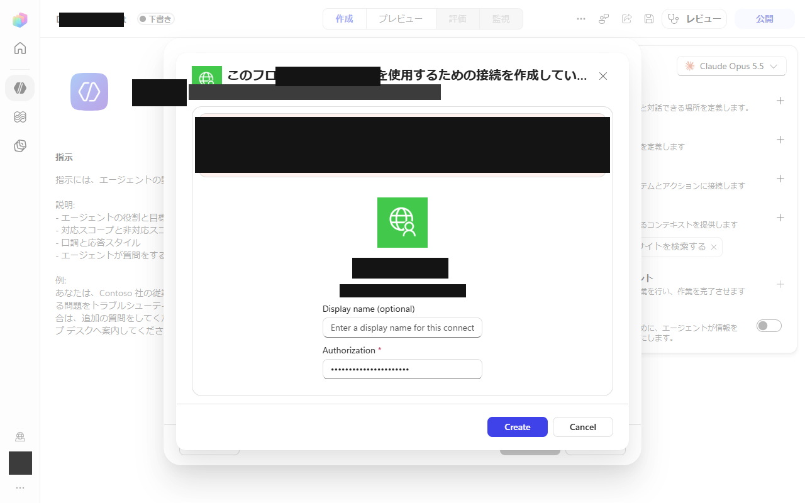

日本語 | [English](#english)

# Copilot Studio で独自の MCP 接続を作れないとき: カスタムコネクタもトンネルも使わない経路

これは、どの組織でも使える手順書です。Copilot Studio のエージェントが自社の MCP サーバーに届くために必要な接続を作成できない場合にどうするか、そして Microsoft 提供のツールだけで同じ目的に到達する方法を説明します。この経路は代替のアーキテクチャです。カスタムコネクタも、トンネルも、ルールの例外も必要ありません。

> **注意 - 何かを公開する前に必ず読んでください。**
> API キー認証なしで公開したツール(「キーなし登録」)は、**リンクを知っている全員**が使えます。
> そのため、一人ひとりが**自分専用**の環境(自分のエージェントと自分のマシン)を作らなければなりません。
> 他人のツールや他人のエージェントのリンクは絶対に使わないでください。使うと**その人のマシン**でコマンドが実行され、**その人のデータ**が読まれます。
> [注意: キーなしのツールを共有しない](#caution-ja)を参照してください。

## 1. 症状

Copilot Studio のエージェントに MCP サーバー(またはカスタムコネクタ)を追加します。Copilot Studio が接続を作成しようとすると、接続を作成できません。ダイアログには、組織の管理者設定によってブロックされた、またはそれ以外の理由で作成に失敗した、と表示されます。エラーは次のような形式です。

> `<your tool>` への接続を作成できませんでした。組織の管理者設定によってブロックされたか、接続を作成できませんでした。管理者に連絡してください。

*上の画像は、接続を作るダイアログです。作成を実行すると、このダイアログに、前述のエラーが帯で表示されます(画像ではその帯を黒塗りにしています)。*

このメッセージについて知っておくとよい点:

- このメッセージは**接続**を作成するときに出るので、認証とは無関係です。「API キー」と「認証なし」を切り替えても結果は変わらず、正しいキーを入れても変わりません。
- どのコネクタと MCP サーバーを環境内で一緒に使えるかは、組織の管理者設定で決まります。カスタム MCP サーバーは、ある環境では使えないことがよくあります。
- その設定を変えられるのは管理者だけです。以下の経路は、設定を変えることに依存しません。自前のカスタムコネクタを必要としない、代替のアーキテクチャです。

## 2. 経路

考え方: エージェントに自分のツールへのコネクタを持たせる代わりに、Microsoft 提供のツールだけを持つエージェントを使い、ローカルのツールへの呼び出しは**会話**に運ばせます。

1. **Standard タイプの Copilot Studio エージェントを作成します。** 通常の「Standard」エージェントタイプを使います。Copilot Studio のクレジットを消費する GitHub-Copilot タイプは使わ**ない**でください。
2. エージェントの設定で、そのエージェントの**モデルを選びます**。
3. **使用を許可されている Microsoft 提供のツールだけを追加します。** たとえば Work IQ MCP ツール(Mail、Calendar、Teams、OneDrive、SharePoint、Copilot、User)です。これらを追加したときはエラーなしで接続が作成されました。Microsoft 提供のツールであり、サインインしているユーザーの既存の接続が再利用されるためです。

   

4. エージェントを**公開します**。実行中の Teams チャットを今すぐ新しいバージョンに移す必要がない限り、「最新バージョンを強制する」はオフのままにします。

   

5. **Microsoft 365 Copilot チャネルをオンにします**(「Microsoft 365 Copilot でエージェントを利用可能にする」)。そしてチャネルを追加します。

   

6. Microsoft 365 Copilot の**エージェントストアからエージェントを追加します**(エージェントストアを開き、エージェントを開き、「追加」を押します)。

   
   

7. エージェントのチャットを開いたら、アドレスバーからそのエージェントの**チャット URL をコピーします**。
8. **同意カードをそれぞれ一度ずつ承認します。** エージェントが各ツールを初めて使うとき、チャットに同意カードが表示されます。使うつもりのツールについて承認してください。各カードは、エージェントが**あなた自身の**メール、予定表、チャット、ファイルにアクセスすることを許可するものなので、承認する前に読んでください。
9. 使用する Copilot チャットを選ぶ**製品の設定に URL を入れます**。

この後、製品はチャットを通じてエージェントと対話します。コネクタは使いません。製品がローカルのツールを必要とするとき、モデルはツール名とその引数を書いたコードブロックを書き、ローカルマシン上の製品がそのツールを実行して、結果を次のチャットメッセージとして返します。マシンへの外部からの接続も、トンネルも、カスタムコネクタも必要ありません。(この考え方のより詳しい説明が、このリポジトリの新しいバージョンの `docs/connector_less_route.md` にある場合があります。)

## 3. Teams と Microsoft 365 へのディープリンク

エージェントを公開してチャネルをオンにすると、検索しなくてもリンクから開けるようになります。使われているリンクの形は2種類です。プレースホルダーを自分の値に置き換え、実際の識別子は公開しないでください。

- `https://teams.microsoft.com/l/app/<appId>` は、Teams でエージェントのアプリページ(「開く」と「追加」があるページ)を開きます。`<appId>` は、チャネルを追加したときに Teams がエージェントに割り当てたアプリ ID です。
- `https://m365.cloud.microsoft/chat/agent/<id>` は、Microsoft 365 Copilot でエージェントをチャットとして直接開きます。`<id>` は、エージェントストアのリンクボタンに表示されるエージェント ID です。

どちらのリンクも、クリックした人自身のサインインで、その人のためにエージェントを開きます。鍵のように扱ってください(下の注意を参照)。

## 注意: キーなしのツールを共有しない

ツールを **API キー認証なし**で公開すると、ツール自体は呼び出し元が誰かを一切確認しません。リンクまたはチャット URL を持つ人は誰でも使えます。そのツールがマシン上でコマンドを実行したりファイルを読んだりするなら、呼び出した人がそのマシン上で操作することになります。

- **自分の**エージェントを、**自分の**マシンで、**自分用**に作ってください。
- 同僚が「あなたのものをそのまま使える」ように、チャット URL、エージェントのリンク、Teams のリンクを渡さないでください。
- 他人のリンクを自分の製品の設定に貼らないでください。そうすると、自分のリクエストがその人のマシンで実行されてその人のデータに触れ、その人のリクエストが自分に見えるようになります。
- リンクを誤って共有した場合は、ストアからエージェントを削除し、新しいものを公開し直してください(「5. 元に戻す」を参照)。

## 4. 制限とリスク

- **管理者は各部分を無効にできます。** Teams でのカスタムアプリのアップロード、Microsoft 365 Copilot チャネル、エージェントの共有、エージェントの利用は、それぞれテナント設定で無効にできます。手順のどこかがグレーアウトしていたら、それが理由です。
- **公開できる数の上限。** 環境とテナントには、公開できるエージェントの数と、メッセージ数またはクレジットの上限があります。Microsoft 提供のツールだけを使う Standard エージェントは GitHub-Copilot タイプのクレジット消費を避けられますが、上限は適用されます。
- **Work IQ MCP はプレビューです。** ツール名、パラメーター、利用可否は予告なく変わることがあります。
- **同意カードは自分のデータへのアクセスを許可します。** Mail、予定表、Teams、OneDrive、SharePoint の回答は、サインインしているユーザー自身のデータです。使うつもりのものだけを承認してください。
- **ベンダー側の挙動は変わることがあります。** Copilot Studio と Microsoft 365 Copilot のメニュー、文言、ルールは Microsoft によって変更されます。このガイドは下記の日付に動作した内容を説明しています。各手順を再確認してください。
- この経路は組織の設定を回避するのではなく、その**範囲内で**動きます。使うのは Microsoft 提供のツールとチャネルだけで、例外も求めません。ここで使うツールやチャネルを組織が禁止している場合は、使わずに管理者に相談してください。

## 5. 元に戻す

1. Microsoft 365 Copilot で、自分のアカウントの一覧に表示されないように、エージェントを削除します(エージェントのメニューから削除)。
2. Copilot Studio で、エージェントの公開を取り消すか削除します。削除すると、ストアの項目も削除されます。
3. 製品が以前の経路に戻るように、製品の設定からチャット URL を消します。
4. 同意カードを承認した場合は、Microsoft アカウントのアプリとアクセス許可のページで、対応するアクセス許可を確認して削除します。
5. コピーしたり共有したりしたリンク(Teams または Microsoft 365 のディープリンク)を削除します。

## 6. 確認できたことと、できていないこと

確認できたこと(テストテナント1つ、2026年10月):

- Standard タイプのエージェントの作成、モデルの選択、7つの Work IQ ツールの追加、公開、Microsoft 365 チャネルの追加、エージェントストアからのエージェントの追加は、いずれもエラーなしで完了しました。
- 新しいエージェントに対するメール、予定表、Teams、ファイルの質問は、以前に作ったエージェントの回答と一致する回答を返しました。
- 接続を作成できない現象は、ダミーのカスタムツールで、API キードありでも認証なしでも再現しました。

確認できていないこと:

- ほかのテナント、ほかの管理者設定、ほかのリージョンやライセンス。
- 長期的な安定性。Microsoft がプレビューのツールを変更した後の挙動を含みます。
- 同意カードの手順は、製品の挙動から説明しています。同意カードのスクリーンショットはここには含まれていません。

## 画像

`docs/img/custom_mcp_fallback/` にあるスクリーンショットは加工済みです。名前、アカウント、アバター、エージェント名、識別子は塗りつぶしの四角で覆われています。スクリーンショットの製品言語は日本語です。

---

# When you cannot build your own MCP connection in Copilot Studio: a route with no custom connector and no tunnel

This is a how-to for any organisation. It describes what to do when the
connection that a Copilot Studio agent needs in order to reach your own MCP
server cannot be created, and how to reach the same goal through
Microsoft-provided tools only. The route is an alternative architecture: it
needs no custom connector, no tunnel and no exception to any rule.

> **CAUTION - read before you publish anything.**
> A tool that is published without API-key authentication ("keyless
> registration") can be used by **everyone who has the link**. Every person
> must therefore build their **own** environment: their own agent and their own
> machine. Never use somebody else's tool or somebody else's agent link: doing so
> runs commands on **that person's machine** and reads **that person's data**.
> See [Caution: never share a keyless tool](#caution-never-share-a-keyless-tool).

## 1. The symptom

You add an MCP server (or a custom connector) to a Copilot Studio agent. When
Copilot Studio tries to create the connection, it cannot be created: the dialog
reports that your organisation's administrator settings blocked it, or the
creation fails for another reason. The error is of the form:

> Could not create a connection to `<your tool>`. It was blocked by your
> organisation's administrator settings, or the connection could not be
> created. Contact your administrator.

*The image shows the dialog in which the connection is created. When you press Create, the error above appears in this dialog as a banner (covered with a black box in the image).*

Things worth knowing about this message:

- It is raised when the **connection** is created, so it is independent of
  authentication. Switching between "API key" and "no authentication" does not
  change the outcome, and neither does a correct key.
- Your organisation's administrator settings decide which connectors and MCP
  servers may be used together in an environment. A custom MCP server is often
  not available in a given environment.
- Only the administrator can change those settings. The route below does not
  depend on changing them: it is an alternative architecture that needs no
  custom connector of your own.

## 2. The route

The idea: instead of giving the agent a connector to your own tools, use an
agent that carries only Microsoft-provided tools, and let the **conversation**
carry the calls to your local tools.

1. **Create a Standard-type Copilot Studio agent.** Use the ordinary
   "Standard" agent type. Do **not** use the GitHub-Copilot type, which
   consumes Copilot Studio credits.
2. **Choose a model** for it in the agent settings.
3. **Attach only Microsoft-provided tools that you are allowed to use.** For
   example the Work IQ MCP tools: Mail, Calendar, Teams, OneDrive, SharePoint,
   Copilot and User. Attaching them created the connection without an error,
   because they are Microsoft-provided and the existing connection of the
   signed-in user is reused.

   

4. **Publish** the agent. Leave "force the latest version" off unless you need
   running Teams chats to move to the new version at once.

   

5. **Turn on the Microsoft 365 Copilot channel** ("Make agent available in
   Microsoft 365 Copilot") and add the channel.

   

6. **Add the agent from the agent store** in Microsoft 365 Copilot (open the
   agent store, open the agent, press "Add").

   
   

7. **Copy the chat URL** of the agent from the address bar once its chat is
   open.
8. **Approve each consent card once.** The first time the agent uses each
   tool, a consent card appears in the chat; approve it for the tools you
   intend to use. Each card grants the agent access to **your own** mail,
   calendar, chats or files, so read it before you approve.
9. **Put the URL in the product setting** that selects the Copilot chat to
   use.

After that the product talks to the agent through the chat. It does not use a
connector. When the product needs a local tool, the model writes a code block
that names the tool and its arguments, the product on the local machine runs
that tool and returns the result as the next chat message. No inbound
connection to your machine, no tunnel and no custom connector are needed. (A
longer description of this idea may exist in `docs/connector_less_route.md` in
newer versions of this repository.)

## 3. Deep links for Teams and Microsoft 365

Once the agent is published and the channel is on, a person can open it from
a link instead of searching. Two link shapes are in use; replace the
placeholders with your own values and do not publish real identifiers.

- `https://teams.microsoft.com/l/app/<appId>` opens the agent's app page in
  Teams (the page that has "Open" and "Add"). `<appId>` is the app id that
  Teams assigned to the agent when the channel was added.
- `https://m365.cloud.microsoft/chat/agent/<id>` opens the agent directly as a
  chat in Microsoft 365 Copilot. `<id>` is the agent id shown by the agent
  store link button.

Both links open the agent for the person who clicks them, with that person's
own sign-in. Treat them like a key (see the caution below).

## Caution: never share a keyless tool

When a tool is published **without API-key authentication**, nothing in the
tool itself checks who is calling it. Anyone who holds the link or the chat
URL can use it. If that tool runs commands or reads files on a machine, the
caller acts on that machine.

- Build your **own** agent, on your **own** machine, for your **own** use.
- Do not hand your chat URL, agent link or Teams link to colleagues so that
  they can "just use yours".
- Never paste somebody else's link into your product setting. Doing so makes
  your requests run on that other person's machine and touch that person's
  data, and makes theirs visible to you.
- If a link has been shared by mistake, remove the agent from the store and
  republish a new one (see Rollback).

## 4. Limits and risks

- **Administrators can switch pieces off.** Custom-app upload in Teams, the
  Microsoft 365 Copilot channel, agent sharing or agent use can each be
  disabled by tenant settings. If a step is greyed out, that is the reason.
- **Publish capacity.** Environments and tenants have limits on published
  agents and on messages or credits. A Standard agent with Microsoft-provided
  tools avoids the credit use of the GitHub-Copilot type, but limits still
  apply.
- **Work IQ MCP is a preview.** Tool names, parameters and availability can
  change without notice.
- **Consent cards grant access to your own data.** Mail, calendar, Teams,
  OneDrive and SharePoint answers are the signed-in user's own data. Only
  approve what you intend to use.
- **Vendor-side behaviour can change.** The menus, wording and rules of
  Copilot Studio and Microsoft 365 Copilot are changed by Microsoft. This
  guide describes what worked on the date below; re-check each step.
- This route works **within** your organisation's settings, not around them.
  It uses only Microsoft-provided tools and channels and asks for no
  exception. If your organisation prohibits the tools or channels used here,
  do not use it; ask the administrator.

## 5. Rolling back

1. In Microsoft 365 Copilot, remove the agent (agent menu, remove) so that
   your account no longer lists it.
2. In Copilot Studio, unpublish or delete the agent. Deleting it also removes
   its store entry.
3. Clear the chat URL from the product setting so the product returns to its
   previous route.
4. If you approved consent cards, review and remove the corresponding
   permissions in your Microsoft account's app and permission page.
5. Delete any link you copied or shared (Teams or Microsoft 365 deep links).

## 6. What was verified and what was not

Verified (one test tenant, October 2026):

- Creating a Standard-type agent, choosing a model, attaching the seven Work IQ
  tools, publishing, adding the Microsoft 365 channel and adding the agent from
  the agent store all completed without an error.
- Mail, calendar, Teams and file questions put to the new agent returned
  answers matching those of an agent that had been built earlier.
- The failure to create a connection was reproduced with a dummy custom tool,
  both with API-key and with no authentication.

Not verified:

- Other tenants, other administrator settings, other regions or licences.
- Long-term stability, including behaviour after Microsoft changes the preview
  tools.
- The consent card step is described from the product's behaviour; no
  screenshot of a consent card is included here.

## Images

The screenshots in `docs/img/custom_mcp_fallback/` are redacted: names,
accounts, avatars, agent names and identifiers are covered by solid boxes. The
product language of the screenshots is Japanese.
