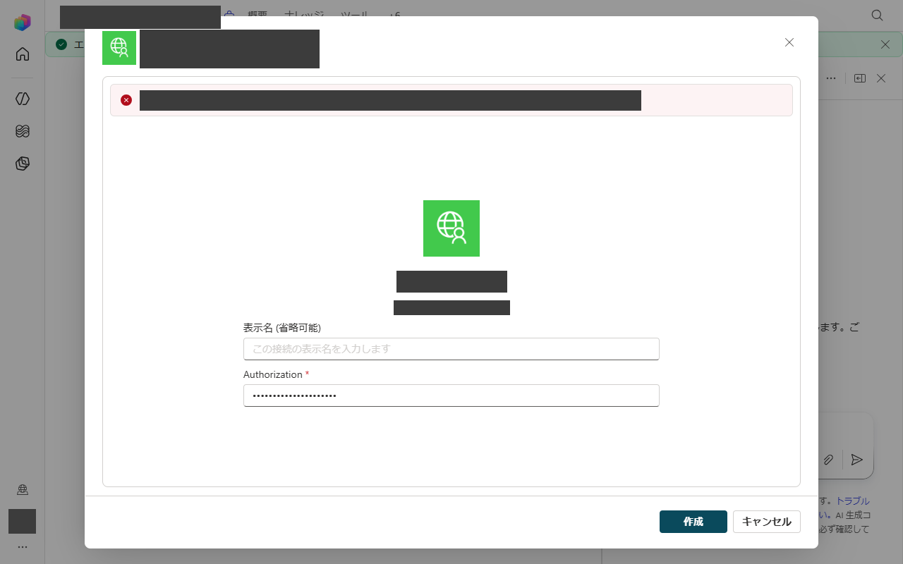
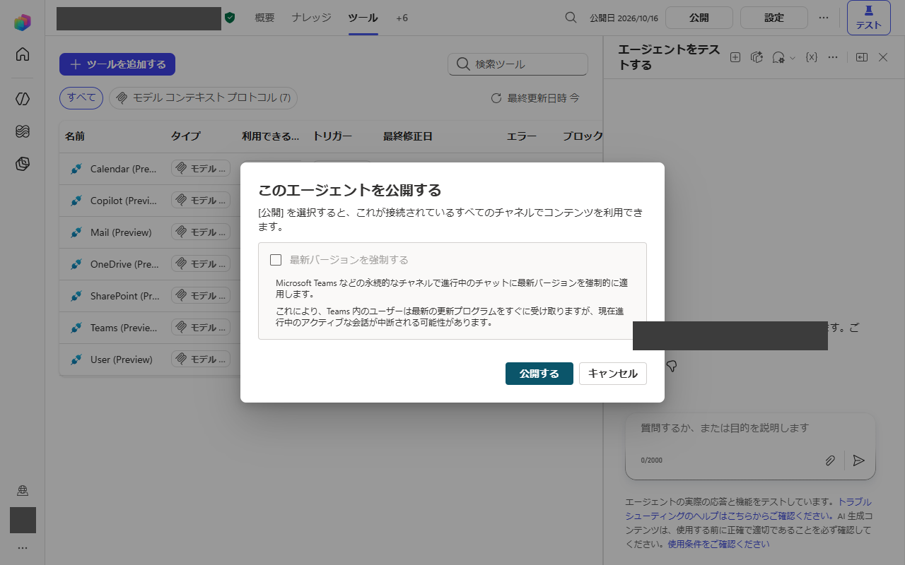
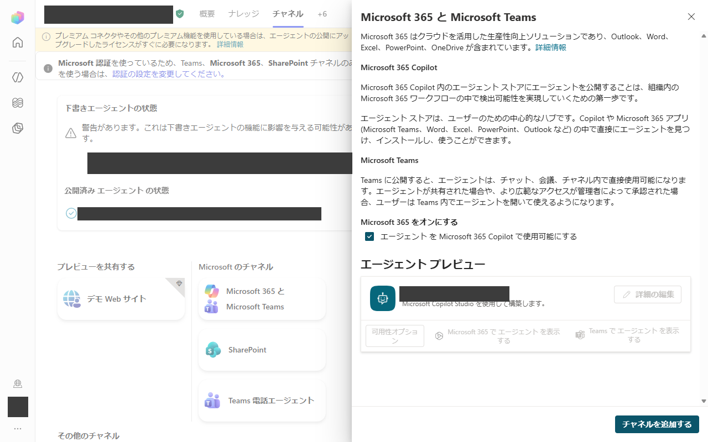
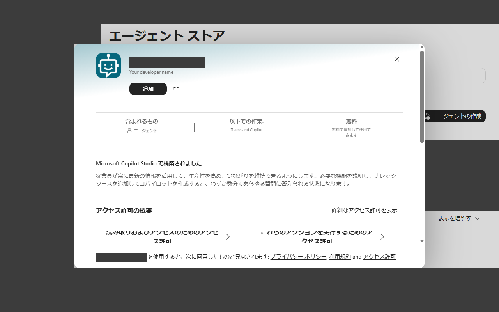
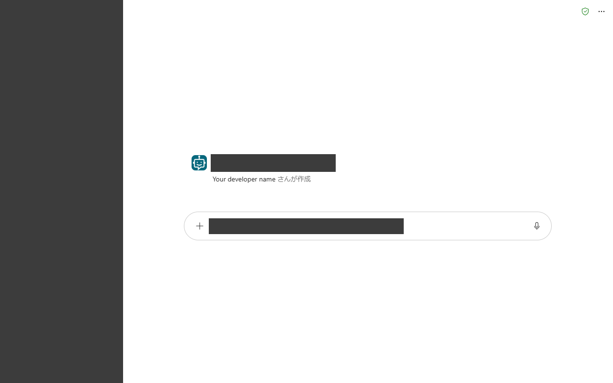

日本語 | [English](#english)

# MCP の接続が作れないときの経路: カスタムコネクタもトンネルも使わない

Copilot Studio で自分の MCP サーバーへの接続が作れないときに、Microsoft 提供のツールだけで同じことを実現する手順です。どの組織でも使えます。カスタムコネクタもトンネルも要らず、組織のルールの例外を求める必要もありません。

> **注意: 公開する前に必ず読んでください。**
> API キー認証なし(「キーなし登録」)で公開したツールは、**リンクを知っている人なら誰でも**使えます。
> だから、各自が**自分の環境**(自分のエージェントと自分のマシン)を作ってください。
> 他の人のツールやエージェントのリンクは使わないでください。使うと**その人のマシン**でコマンドが動き、**その人のデータ**が読まれます。
> 詳しくは[キーなしのツールを共有しない](#caution-ja)を見てください。

## 1. こんな症状のとき

Standard タイプの Copilot Studio エージェントに、MCP サーバー(またはカスタムコネクタ)のツールを追加すると、接続の作成で失敗します。接続を作るダイアログで「作成」を押すと上部に赤い帯が出ます。帯には組織のポリシーで接続の作成がブロックされたという英語のメッセージが出ます(下の画像のとおりです)。ダイアログは閉じません。

このメッセージについて知っておくと役に立つことがあります。

- 出るのは接続を作る時点なので認証とは関係ありません。「API キー」と「認証なし」のどちらにしても正しいキーを入れても結果は変わりません。
- 環境の中でどのコネクタや MCP サーバーを使えるかは組織の管理者設定で決まります。カスタム MCP サーバーは使えない環境がよくあります。
- この設定を変えられるのは管理者だけです。下の経路は設定の変更に頼りません。自前のカスタムコネクタを使わない、別の作りです。

## 2. 手順

考え方は次のとおりです。エージェントに自分のツールへのコネクタを持たせず、Microsoft 提供のツールだけを持つエージェントを使います。ローカルのツールを呼ぶ処理は、**会話**に乗せて運びます。

1. **Standard タイプの Copilot Studio エージェントを作ります。** 通常の「Standard」を選びます。Copilot Studio のクレジットを消費する GitHub-Copilot タイプは選ばないでください。
2. エージェントの設定で**モデルを選びます**。
3. **使うことを許可されている Microsoft 提供のツールだけを追加します。** たとえば Work IQ MCP のツール(Mail、Calendar、Teams、OneDrive、SharePoint、Copilot、User)です。これらはエラーなしで接続が作れました。Microsoft 提供のツールでサインイン中のユーザーの既存の接続が使われるためです。

   

4. エージェントを**公開します**。動いている Teams のチャットを今すぐ新しいバージョンに切り替える必要がなければ、「最新バージョンを強制する」はオフのままにします。

   

5. **Microsoft 365 Copilot チャネルをオンにします**(「エージェントを Microsoft 365 Copilot で使用可能にする」)。そのうえでチャネルを追加します。

   

6. Microsoft 365 Copilot の**エージェントストアから、エージェントを追加します**。ストアを開き、エージェントを開いて「追加」を押します。

   
   

7. エージェントのチャットを開き、アドレスバーから**チャットの URL をコピーします**。
8. **同意カードをそれぞれ一度ずつ承認します。** エージェントが各ツールを初めて使うときにチャットに同意カードが出ます。使うツールの分だけ承認してください。どのカードもエージェントが**自分自身の**メール、予定表、チャット、ファイルにアクセスすることを許可するものです。承認する前に内容を読んでください。
9. **製品の設定に URL を入れます。** どの Copilot チャットを使うかはこの URL で決まります。

これ以降、製品はチャットを通してエージェントとやり取りします。コネクタは使いません。製品がローカルのツールを必要とするとモデルはツール名と引数を書いたコードブロックを返します。ローカルの製品がそのツールを実行し、結果を次のチャットのメッセージで返します。外からマシンに接続する必要はなく、トンネルもカスタムコネクタも要りません。(この方式の詳しい説明はリポジトリの新しい版の `docs/connector_less_route.md` にあります。)

## 3. Teams と Microsoft 365 へのリンク

エージェントを公開してチャネルをオンにすると検索しなくてもリンクから開けます。リンクの形は2種類あります。`<>` の部分は自分の値に置き換えてください。実際の識別子は公開しないでください。

- `https://teams.microsoft.com/l/app/<appId>`: Teams でエージェントのアプリのページ(「開く」「追加」があるページ)を開きます。`<appId>` はチャネルを追加したときに Teams がエージェントに付けるアプリ ID です。
- `https://m365.cloud.microsoft/chat/agent/<id>`: Microsoft 365 Copilot でエージェントのチャットを直接開きます。`<id>` はエージェントストアのリンクのボタンに出るエージェント ID です。

どちらのリンクもクリックした人が自分のサインインでそのエージェントを開きます。鍵と同じように扱ってください(次の注意を見てください)。

## 注意: キーなしのツールを共有しない

ツールを **API キー認証なし**で公開するとツール側は誰が呼んでいるのかを確認しません。リンクやチャットの URL を知っている人なら誰でも使えます。そのツールがマシン上でコマンドを実行したりファイルを読んだりするなら、呼んだ人がそのマシンで操作することになります。

- **自分の**エージェントを、**自分の**マシンで、**自分のために**作ってください。
- 同僚がそのまま使えるようにチャットの URL やエージェントのリンク、Teams のリンクを渡すのはやめてください。
- 他の人のリンクを自分の製品の設定に貼らないでください。貼ると自分の依頼がその人のマシンで動いてその人のデータに触れます。その人の依頼も自分に見えてしまいます。
- リンクをうっかり共有したときはストアからエージェントを削除して、新しく公開し直してください(「5. 元に戻す」を見てください)。

## 4. 制限とリスク

- **管理者は各段階を無効にできます。** Teams へのカスタムアプリのアップロード、Microsoft 365 Copilot チャネル、エージェントの共有、エージェントの利用はどれもテナントの設定で無効にできます。手順のどこかが灰色で押せないときはこれが理由です。
- **公開できる数に上限があります。** 環境とテナントごとに公開できるエージェントの数とメッセージ数やクレジットの上限があります。Microsoft 提供のツールだけの Standard エージェントなら、GitHub-Copilot タイプのクレジット消費は避けられますが、上限は同じようにかかります。
- **Work IQ MCP はプレビューです。** ツール名、パラメーター、使えるかどうかは予告なく変わることがあります。
- **同意カードは自分のデータへのアクセスを許可するものです。** Mail、予定表、Teams、OneDrive、SharePoint の答えはサインインしている本人のデータです。使うものだけを承認してください。
- **Microsoft 側の動作は変わることがあります。** Copilot Studio や Microsoft 365 Copilot のメニュー、文言、ルールは Microsoft が変更します。このガイドは下に書いた時点で動いた内容です。各手順は実際の画面で確かめてください。
- この経路は組織の設定を回避するものではなく、**設定の範囲内**で動きます。使うのは Microsoft 提供のツールとチャネルだけで例外は求めません。ここで使うツールやチャネルを組織が禁止しているときは使わずに管理者に相談してください。

## 5. 元に戻す

1. Microsoft 365 Copilot で自分の一覧からエージェントを外します(エージェントのメニューから削除)。
2. Copilot Studio でエージェントの公開を取り消すか、削除します。削除するとストアの項目も消えます。
3. 製品が元の経路に戻るように製品の設定からチャットの URL を消します。
4. 同意カードを承認していたら Microsoft アカウントの「アプリとアクセス許可」のページで、対応する許可を確認して削除します。
5. コピーしたり共有したりしたリンク(Teams や Microsoft 365 へのリンク)を削除します。

## 6. 確認できたこと、できていないこと

確認できたこと(テスト用テナント1つ、2026年10月):

- Standard タイプのエージェントの作成、モデルの選択、7つの Work IQ ツールの追加、公開、Microsoft 365 チャネルの追加、エージェントストアからの追加はすべてエラーなしで終わりました。
- 新しいエージェントにメール、予定表、Teams、ファイルのことを聞くと以前に作ったエージェントと同じ内容の答えが返りました。
- 接続を作れない現象はダミーのカスタムツールを使って再現しました。GitHub Copilot タイプのエージェントでは API キーを付けても認証なしでも同じでした。Standard タイプのエージェントでも API キーの欄にダミーの文字列を入れた接続で同じブロックを確認しました(2026年10月19日)。

確認できていないこと:

- ほかのテナント、ほかの管理者設定、ほかのリージョンやライセンスでの動作。
- 長く使ったときの安定性。Microsoft がプレビューのツールを変えたあとの動作も含みます。
- 同意カードの手順。製品の動作から書いたもので同意カードの画面の写真はここにはありません。

## 画像について

`docs/img/custom_mcp_fallback/` の画像は加工済みです。名前、アカウント、アイコン、エージェント名、識別子などは塗りつぶした四角で隠しています。画面の言語は日本語です(最初の画像のエラーの帯だけは英語です)。

---

# When you cannot build your own MCP connection in Copilot Studio: a route with no custom connector and no tunnel

This is a how-to for any organisation. It describes what to do when the
connection that a Copilot Studio agent needs in order to reach your own MCP
server cannot be created, and how to reach the same goal through
Microsoft-provided tools only. The route is an alternative architecture: it
needs no custom connector, no tunnel and no exception to any rule.

> **CAUTION - read before you publish anything.**
> A tool that is published without API-key authentication ("keyless
> registration") can be used by **everyone who has the link**. Every person
> must therefore build their **own** environment: their own agent and their own
> machine. Never use somebody else's tool or somebody else's agent link: doing so
> runs commands on **that person's machine** and reads **that person's data**.
> See [Caution: never share a keyless tool](#caution-never-share-a-keyless-tool).

## 1. The symptom

You add the tool of an MCP server (or a custom connector) to a Standard-type Copilot Studio agent.
When Copilot Studio tries to create the connection, it fails: in the dialog in which the connection
is created, pressing Create shows a red error banner at the top, and the dialog stays open. The
message says, in substance, that the creation of this connection was blocked by your organisation's
settings (it is shown in English).

Things worth knowing about this message:

- It is raised when the **connection** is created, so it is independent of
  authentication. Switching between "API key" and "no authentication" does not
  change the outcome, and neither does a correct key.
- Your organisation's administrator settings decide which connectors and MCP
  servers may be used together in an environment. A custom MCP server is often
  not available in a given environment.
- Only the administrator can change those settings. The route below does not
  depend on changing them: it is an alternative architecture that needs no
  custom connector of your own.

## 2. The route

The idea: instead of giving the agent a connector to your own tools, use an
agent that carries only Microsoft-provided tools, and let the **conversation**
carry the calls to your local tools.

1. **Create a Standard-type Copilot Studio agent.** Use the ordinary
   "Standard" agent type. Do **not** use the GitHub-Copilot type, which
   consumes Copilot Studio credits.
2. **Choose a model** for it in the agent settings.
3. **Attach only Microsoft-provided tools that you are allowed to use.** For
   example the Work IQ MCP tools: Mail, Calendar, Teams, OneDrive, SharePoint,
   Copilot and User. Attaching them created the connection without an error,
   because they are Microsoft-provided and the existing connection of the
   signed-in user is reused.

   

4. **Publish** the agent. Leave "force the latest version" off unless you need
   running Teams chats to move to the new version at once.

   

5. **Turn on the Microsoft 365 Copilot channel** ("Make agent available in
   Microsoft 365 Copilot") and add the channel.

   

6. **Add the agent from the agent store** in Microsoft 365 Copilot (open the
   agent store, open the agent, press "Add").

   
   

7. **Copy the chat URL** of the agent from the address bar once its chat is
   open.
8. **Approve each consent card once.** The first time the agent uses each
   tool, a consent card appears in the chat; approve it for the tools you
   intend to use. Each card grants the agent access to **your own** mail,
   calendar, chats or files, so read it before you approve.
9. **Put the URL in the product setting** that selects the Copilot chat to
   use.

After that the product talks to the agent through the chat. It does not use a
connector. When the product needs a local tool, the model writes a code block
that names the tool and its arguments, the product on the local machine runs
that tool and returns the result as the next chat message. No inbound
connection to your machine, no tunnel and no custom connector are needed. (A
longer description of this idea may exist in `docs/connector_less_route.md` in
newer versions of this repository.)

## 3. Deep links for Teams and Microsoft 365

Once the agent is published and the channel is on, a person can open it from
a link instead of searching. Two link shapes are in use; replace the
placeholders with your own values and do not publish real identifiers.

- `https://teams.microsoft.com/l/app/<appId>` opens the agent's app page in
  Teams (the page that has "Open" and "Add"). `<appId>` is the app id that
  Teams assigned to the agent when the channel was added.
- `https://m365.cloud.microsoft/chat/agent/<id>` opens the agent directly as a
  chat in Microsoft 365 Copilot. `<id>` is the agent id shown by the agent
  store link button.

Both links open the agent for the person who clicks them, with that person's
own sign-in. Treat them like a key (see the caution below).

## Caution: never share a keyless tool

When a tool is published **without API-key authentication**, nothing in the
tool itself checks who is calling it. Anyone who holds the link or the chat
URL can use it. If that tool runs commands or reads files on a machine, the
caller acts on that machine.

- Build your **own** agent, on your **own** machine, for your **own** use.
- Do not hand your chat URL, agent link or Teams link to colleagues so that
  they can "just use yours".
- Never paste somebody else's link into your product setting. Doing so makes
  your requests run on that other person's machine and touch that person's
  data, and makes theirs visible to you.
- If a link has been shared by mistake, remove the agent from the store and
  republish a new one (see Rollback).

## 4. Limits and risks

- **Administrators can switch pieces off.** Custom-app upload in Teams, the
  Microsoft 365 Copilot channel, agent sharing or agent use can each be
  disabled by tenant settings. If a step is greyed out, that is the reason.
- **Publish capacity.** Environments and tenants have limits on published
  agents and on messages or credits. A Standard agent with Microsoft-provided
  tools avoids the credit use of the GitHub-Copilot type, but limits still
  apply.
- **Work IQ MCP is a preview.** Tool names, parameters and availability can
  change without notice.
- **Consent cards grant access to your own data.** Mail, calendar, Teams,
  OneDrive and SharePoint answers are the signed-in user's own data. Only
  approve what you intend to use.
- **Vendor-side behaviour can change.** The menus, wording and rules of
  Copilot Studio and Microsoft 365 Copilot are changed by Microsoft. This
  guide describes what worked on the date below; re-check each step.
- This route works **within** your organisation's settings, not around them.
  It uses only Microsoft-provided tools and channels and asks for no
  exception. If your organisation prohibits the tools or channels used here,
  do not use it; ask the administrator.

## 5. Rolling back

1. In Microsoft 365 Copilot, remove the agent (agent menu, remove) so that
   your account no longer lists it.
2. In Copilot Studio, unpublish or delete the agent. Deleting it also removes
   its store entry.
3. Clear the chat URL from the product setting so the product returns to its
   previous route.
4. If you approved consent cards, review and remove the corresponding
   permissions in your Microsoft account's app and permission page.
5. Delete any link you copied or shared (Teams or Microsoft 365 deep links).

## 6. What was verified and what was not

Verified (one test tenant, October 2026):

- Creating a Standard-type agent, choosing a model, attaching the seven Work IQ
  tools, publishing, adding the Microsoft 365 channel and adding the agent from
  the agent store all completed without an error.
- Mail, calendar, Teams and file questions put to the new agent returned
  answers matching those of an agent that had been built earlier.
- The failure to create a connection was reproduced with a dummy custom tool. In a GitHub
  Copilot-type agent it was the same with an API key and with no authentication. In a Standard-type
  agent the same block was confirmed with a connection whose key field held a dummy string
  (19 October 2026).

Not verified:

- Other tenants, other administrator settings, other regions or licences.
- Long-term stability, including behaviour after Microsoft changes the preview
  tools.
- The consent card step is described from the product's behaviour; no
  screenshot of a consent card is included here.

## Images

The screenshots in `docs/img/custom_mcp_fallback/` are redacted: names,
accounts, avatars, agent names and identifiers are covered by solid boxes. The
product language of the screenshots is Japanese.
