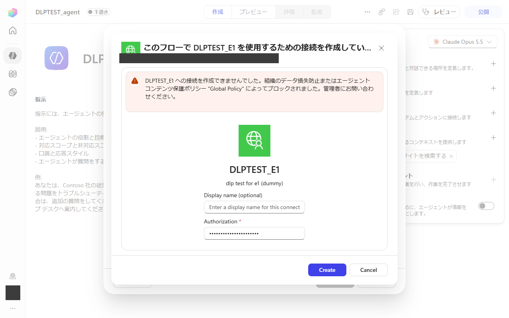
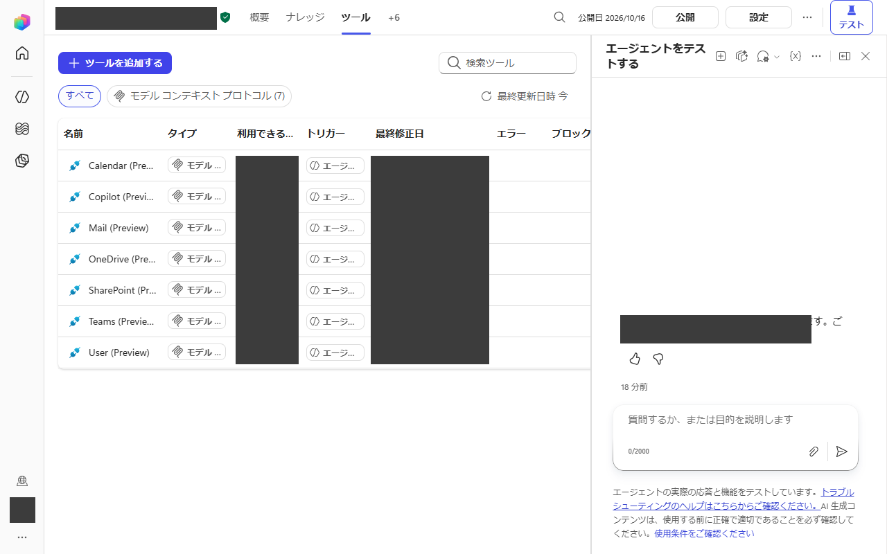
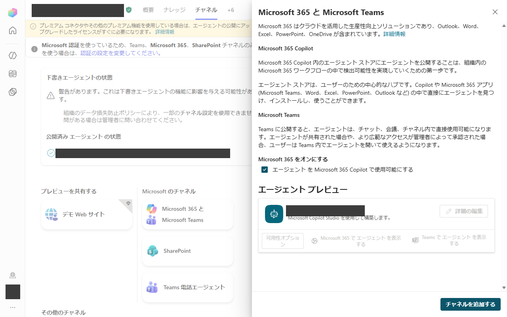

# When the DLP policy of Copilot Studio blocks your MCP connection

A route with no custom connector and no tunnel.

This is a how-to for any organisation. It describes what to do when a data
loss prevention (DLP) policy stops you from creating the connection that a
Copilot Studio agent needs in order to reach your own MCP server, and how to
reach the same goal through Microsoft-provided tools only.

> **CAUTION - read before you publish anything.**
> A tool that is published without API-key authentication ("keyless
> registration") can be used by **everyone who has the link**. Every person
> must therefore build their **own** environment: their own agent and their own
> machine. Never use somebody else's tool or somebody else's agent link: doing so
> runs commands on **that person's machine** and reads **that person's data**.
> See [Caution: never share a keyless tool](#caution-never-share-a-keyless-tool).

## 1. The symptom

You add an MCP server (or a custom connector) to a Copilot Studio agent. When
Copilot Studio tries to create the connection, the dialog shows an error of the
form:

> Could not create a connection to `<your tool>`. It was blocked by your
> organisation's data loss prevention or agent content protection policy
> "`<policy name>`". Contact your administrator.

Things worth knowing about this message:

- It is raised when the **connection** is created, so it is independent of
  authentication. Switching between "API key" and "no authentication" does not
  change the outcome, and neither does a correct key.
- The policy decides which connectors and MCP servers may be used together in
  an environment. A custom MCP server is usually in the blocked group.
- Only the administrator who owns the policy can change it. Do not try to
  hide, rename or tunnel around it: the point of the route below is that it
  needs nothing the policy forbids.

## 2. The route

The idea: instead of giving the agent a connector to your own tools, use an
agent that carries only Microsoft-provided tools, and let the **conversation**
carry the calls to your local tools.

1. **Create a Standard-type Copilot Studio agent.** Use the ordinary
   "Standard" agent type. Do **not** use the GitHub-Copilot type, which
   consumes Copilot Studio credits.
2. **Choose a model** for it in the agent settings.
3. **Attach only Microsoft-provided tools that you are allowed to use.** For
   example the Work IQ MCP tools: Mail, Calendar, Teams, OneDrive, SharePoint,
   Copilot and User. Attaching them did not trigger the DLP block, because
   they are Microsoft-provided and the existing connection of the signed-in
   user is reused.

   

4. **Publish** the agent. Leave "force the latest version" off unless you need
   running Teams chats to move to the new version at once.

   

5. **Turn on the Microsoft 365 Copilot channel** ("Make agent available in
   Microsoft 365 Copilot") and add the channel.

   

6. **Add the agent from the agent store** in Microsoft 365 Copilot (open the
   agent store, open the agent, press "Add").

   
   

7. **Copy the chat URL** of the agent from the address bar once its chat is
   open.
8. **Approve each consent card once.** The first time the agent uses each
   tool, a consent card appears in the chat; approve it for the tools you
   intend to use. Each card grants the agent access to **your own** mail,
   calendar, chats or files, so read it before you approve.
9. **Put the URL in the product setting** that selects the Copilot chat to
   use.

After that the product talks to the agent through the chat. It does not use a
connector. When the product needs a local tool, the model writes a code block
that names the tool and its arguments, the product on the local machine runs
that tool and returns the result as the next chat message. No inbound
connection to your machine, no tunnel and no custom connector are needed. (A
longer description of this idea may exist in `docs/connector_less_route.md` in
newer versions of this repository.)

## 3. Deep links for Teams and Microsoft 365

Once the agent is published and the channel is on, a person can open it from
a link instead of searching. Two link shapes are in use; replace the
placeholders with your own values and do not publish real identifiers.

- `https://teams.microsoft.com/l/app/<appId>` opens the agent's app page in
  Teams (the page that has "Open" and "Add"). `<appId>` is the app id that
  Teams assigned to the agent when the channel was added.
- `https://m365.cloud.microsoft/chat/agent/<id>` opens the agent directly as a
  chat in Microsoft 365 Copilot. `<id>` is the agent id shown by the agent
  store link button.

Both links open the agent for the person who clicks them, with that person's
own sign-in. Treat them like a key (see the caution below).

## Caution: never share a keyless tool

When a tool is published **without API-key authentication**, nothing in the
tool itself checks who is calling it. Anyone who holds the link or the chat
URL can use it. If that tool runs commands or reads files on a machine, the
caller acts on that machine.

- Build your **own** agent, on your **own** machine, for your **own** use.
- Do not hand your chat URL, agent link or Teams link to colleagues so that
  they can "just use yours".
- Never paste somebody else's link into your product setting. Doing so makes
  your requests run on that other person's machine and touch that person's
  data, and makes theirs visible to you.
- If a link has been shared by mistake, remove the agent from the store and
  republish a new one (see Rollback).

## 4. Limits and risks

- **Administrators can switch pieces off.** Custom-app upload in Teams, the
  Microsoft 365 Copilot channel, agent sharing or agent use can each be
  disabled by tenant policy. If a step is greyed out, that is the reason.
- **Publish capacity.** Environments and tenants have limits on published
  agents and on messages or credits. A Standard agent with Microsoft-provided
  tools avoids the credit use of the GitHub-Copilot type, but limits still
  apply.
- **Work IQ MCP is a preview.** Tool names, parameters and availability can
  change without notice.
- **Consent cards grant access to your own data.** Mail, calendar, Teams,
  OneDrive and SharePoint answers are the signed-in user's own data. Only
  approve what you intend to use.
- **Vendor-side behaviour can change.** The menus, wording and rules of
  Copilot Studio and Microsoft 365 Copilot are changed by Microsoft. This
  guide describes what worked on the date below; re-check each step.
- This route works **with** your DLP policy, not around it. If your
  organisation prohibits the tools or channels used here, do not use it; ask
  the administrator.

## 5. Rolling back

1. In Microsoft 365 Copilot, remove the agent (agent menu, remove) so that
   your account no longer lists it.
2. In Copilot Studio, unpublish or delete the agent. Deleting it also removes
   its store entry.
3. Clear the chat URL from the product setting so the product returns to its
   previous route.
4. If you approved consent cards, review and remove the corresponding
   permissions in your Microsoft account's app and permission page.
5. Delete any link you copied or shared (Teams or Microsoft 365 deep links).

## 6. What was verified and what was not

Verified (one test tenant, October 2026):

- Creating a Standard-type agent, choosing a model, attaching the seven Work IQ
  tools, publishing, adding the Microsoft 365 channel and adding the agent from
  the agent store all completed without a DLP message.
- Mail, calendar, Teams and file questions put to the new agent returned
  answers matching those of an agent that had been built earlier.
- The DLP block message on connection creation was reproduced with a dummy
  custom tool, both with API-key and with no authentication.

Not verified:

- Other tenants, other DLP policies, other regions or licences.
- Long-term stability, including behaviour after Microsoft changes the preview
  tools.
- The consent card step is described from the product's behaviour; no
  screenshot of a consent card is included here.

## Images

The screenshots in `docs/img/dlp_fallback/` are redacted: names, accounts,
avatars, agent names and identifiers are covered by solid boxes. The product
language of the screenshots is Japanese.
